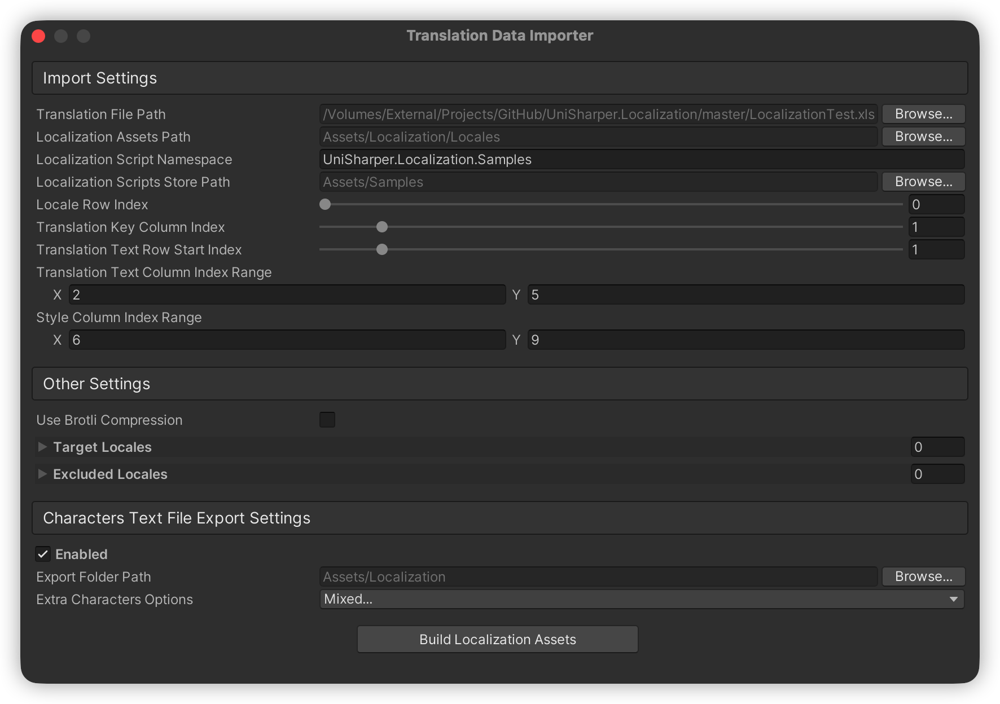
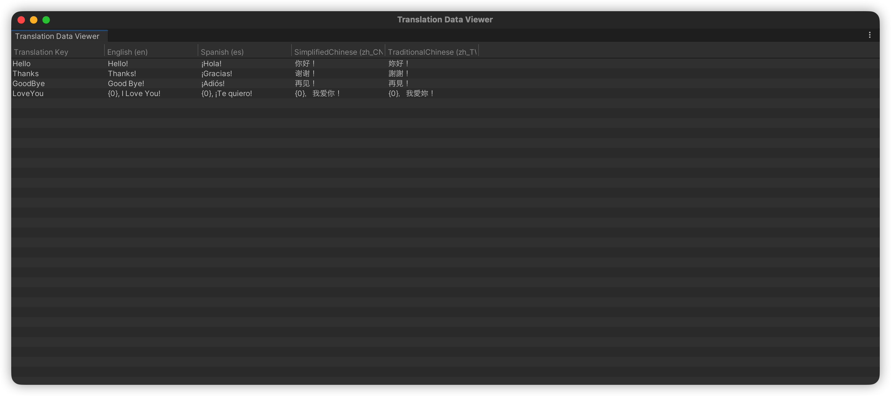
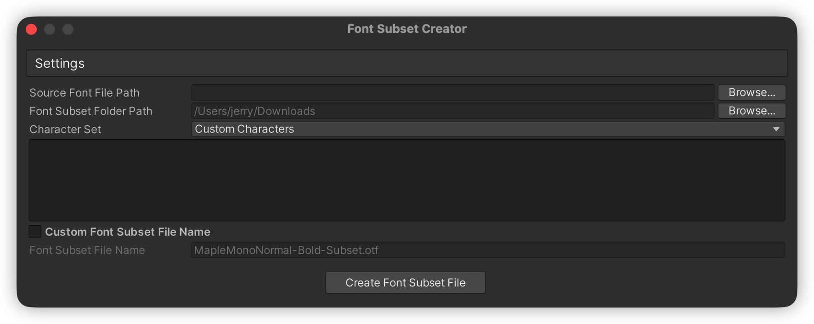

# UniSharper.Localization

[](LICENSE.md)
[](https://unity.com/)
[](https://openupm.com/packages/io.github.idreamsofgame.unisharper.localization/)

**UniSharper.Localization** is a serialization-data-driven text localization tool for Unity applications. It lets you manage all of your translations in an Excel workbook, build them into compact binary locale assets with a single click in the Editor, and load them at runtime through a lightweight, allocation-friendly API. It works with both Unity UI (uGUI) and TextMesh Pro, and even lets translations carry per-text style information (font, font size, material, color gradient, ...) that can be applied to UI text at runtime.

- **Repository:** [github.com/iDreamsOfGame/UniSharper.Localization](https://github.com/iDreamsOfGame/UniSharper.Localization)
- **Changelog:** [CHANGELOG.md](CHANGELOG.md)

## Features

- **Excel-driven workflow** — Maintain all locales, translation keys, texts and style information in a single Excel workbook (`.xlsx`).
- **One-click build** — Import the workbook into serialized binary locale assets (`<locale>.bytes`, powered by [MemoryPack](https://github.com/Cysharp/MemoryPack)) with optional [Brotli](https://en.wikipedia.org/wiki/Brotli) compression.
- **Code generation** — Automatically generates `Locales.cs` (strongly-typed locale fields) and `TranslationKey.cs` (translation key constants), so you never reference translations by raw strings.
- **Style parameters** — Each translation can carry extra key/value style information (e.g. `font`, `fontSize`, `fontMaterial`, `colorGradientPreset`) that your UI code can read and apply at runtime.
- **High-performance formatting** — String formatting is powered by [ZString](https://github.com/Cysharp/ZString) to reduce allocations.
- **Translation Data Viewer** — Browse all built translation data in a spreadsheet-like Editor window.
- **Font Subset Creator** — Create subset font files from the characters actually used by your translations, drastically reducing font asset size — essential for CJK languages.
- **Characters text file export** — Export all characters used by your translations (with optional extra character sets) for use with the Font Subset Creator or TextMesh Pro font asset creation.

## Requirements

- Unity **2022.3** or newer.
- Works with IL2CPP and all Unity platforms.

The following dependencies are installed automatically by the Unity Package Manager:

| Dependency | Purpose |
|---|---|
| [UniSharper.Core](https://openupm.com/packages/io.github.idreamsofgame.unisharper.core/) | Common utilities |
| [MemoryPack](https://github.com/Cysharp/MemoryPack) | Zero-encoding binary serialization of locale data |
| [ZString](https://github.com/Cysharp/ZString) | Allocation-free string formatting |
| [ExcelDataReader](https://github.com/ExcelDataReader/ExcelDataReader) | Reading Excel translation workbooks (Editor only) |
| [SkiaSharp.FontSubset](https://openupm.com/packages/io.github.idreamsofgame.skiasharp.fontsubset/) | Creating font subset files (Editor only) |

## Installation

### Install via Git URL

1. Open your Unity project.
2. Open **Window > Package Manager**.
3. Click the **+** button in the upper-left corner and choose **Add package from git URL...**.
4. Enter the following URL and click **Add**:

   ```
   https://github.com/iDreamsOfGame/UniSharper.Localization.git?path=Assets/UniSharper.Localization
   ```

To install a specific released version, append a tag to the URL:

```
https://github.com/iDreamsOfGame/UniSharper.Localization.git?path=Assets/UniSharper.Localization#upm/4.2.5
```

Alternatively, add it directly to your project's `Packages/manifest.json`:

```json
{
  "dependencies": {
    "io.github.idreamsofgame.unisharper.localization": "https://github.com/iDreamsOfGame/UniSharper.Localization.git?path=Assets/UniSharper.Localization#upm/4.2.5"
  }
}
```

> **Note:** The `?path=Assets/UniSharper.Localization` query is required because the package lives in a subfolder of the repository.

### Install via OpenUPM

The package is published on [OpenUPM](https://openupm.com/packages/io.github.idreamsofgame.unisharper.localization/) as `io.github.idreamsofgame.unisharper.localization`.

**Option A — Package Manager UI (scoped registry):**

1. Open **Edit > Project Settings > Package Manager**.
2. Under **Scoped Registries**, click **+** and add a new registry:
   - **Name:** `OpenUPM`
   - **URL:** `https://package.openupm.com`
   - **Scope(s):** `io.github.idreamsofgame`
3. Open **Window > Package Manager**, switch to **My Registries**, and install **UniSharper.Localization**.

**Option B — Edit `Packages/manifest.json` directly:**

```json
{
  "scopedRegistries": [
    {
      "name": "OpenUPM",
      "url": "https://package.openupm.com",
      "scopes": ["io.github.idreamsofgame"]
    }
  ],
  "dependencies": {
    "io.github.idreamsofgame.unisharper.localization": "4.2.5"
  }
}
```

**Option C — OpenUPM CLI:**

```bash
openupm add io.github.idreamsofgame.unisharper.localization
```

## The Localization Workflow

A typical localization workflow with UniSharper.Localization looks like this:

1. Maintain translations in an Excel workbook.
2. Import the workbook with the **Translation Data Importer** to build locale assets and generate scripts.
3. (Optional) Inspect the built data with the **Translation Data Viewer**.
4. (Optional) Create subset fonts with the **Font Subset Creator**.
5. Load the locale assets at runtime and drive your UI through `LocalizationManager`.

All Editor tools live under the **UniSharper > Localization Management** menu.

### 1. Prepare the Translation Workbook

Translations are maintained in an Excel workbook (`.xlsx`). The importer locates data by row/column index, so you can organize the sheet freely. With the default sample settings the layout looks like this:

| | Col 1 | Col 2 (Key) | Col 3–6 (Texts) | Col 7+ (Styles) |
|---|---|---|---|---|
| **Row 1 (Locale Row)** | | | `en`, `es`, `zh_CN`, `zh_TW` | `en.style`, `es.style`, ... |
| **Row 2+ (Translations)** | | `Hello` | `Hello!`, `¡Hola!`, `你好！`, `妳好！` | `(fontSize:14)`, ... |

- The **locale row** declares one locale code (e.g. `en`, `zh_CN`) per translation text column.
- The **key column** holds the translation key of each entry.
- Each **text column** holds the translated text for the locale of that column. Format placeholders such as `{0}` are supported.
- A **style column** (optional) is marked in the locale row with a header of the form `<locale>.<name>` (e.g. `en.style`). A style cell holds key/value pairs in brackets, e.g. `(font:MyFont,fontSize:24)`.

> A complete example is available in [`LocalizationTest.xlsx`](https://github.com/iDreamsOfGame/UniSharper.Localization/blob/master/LocalizationTest.xlsx) at the root of the repository.

### 2. Import Translation Data

Open **UniSharper > Localization Management > Translation > Import Data...** to open the **Translation Data Importer** window:



**Import Settings**

| Setting | Description |
|---|---|
| **Translation File Path** | The Excel workbook (`.xlsx`) that contains the translations. |
| **Localization Assets Path** | Output folder for the built locale data assets. One `<locale>.bytes` file is generated per locale, e.g. `Assets/Localization/Locales/en.bytes`. |
| **Localization Script Namespace** | The namespace used by the generated C# scripts. |
| **Localization Scripts Store Path** | Output folder for the generated scripts (`Locales.cs` and `TranslationKey.cs`). |
| **Locale Row Index** | The 0-based row index that contains the locale codes. |
| **Translation Key Column Index** | The 0-based column index that contains the translation keys. |
| **Translation Text Row Start Index** | The 0-based row index where translation entries start. |
| **Translation Text Column Index Range** | The column range (X–Y) that contains one translated text per locale. |
| **Style Column Index Range** | The column range (X–Y) that contains the optional style information columns. |

**Other Settings**

| Setting | Description |
|---|---|
| **Use Brotli Compression** | Compress the built locale data with Brotli to reduce file size. |
| **Target Locales** | When non-empty, only these locales are built. |
| **Excluded Locales** | These locales are skipped during the build. |

**Characters Text File Export Settings**

| Setting | Description |
|---|---|
| **Enabled** | Export a text file containing every character used by the built translations. This file is the ideal input for the **Font Subset Creator** or TextMesh Pro's font asset creator. |
| **Export Folder Path** | Output folder for the characters text file (e.g. `Assets/Localization/Characters.txt`). |
| **Extra Characters Options** | Additional character sets to append: `Ascii`, `ExtendedAscii`, `AsciiLowercase`, `AsciiUppercase`, `NumbersAndSymbols`, `General Standard Chinese Characters Level 1~3`, and/or custom characters typed into the text area. |

Click **Build Localization Assets** to import the workbook. The importer will:

1. Write one serialized locale asset (`<locale>.bytes`) per locale into **Localization Assets Path**.
2. Generate two scripts into **Localization Scripts Store Path** — `Locales.cs` with a strongly-typed `Locale` field per locale, and `TranslationKey.cs` with a `const string` per translation key. Both files are regenerated on each import, so do not edit them manually.

### 3. View Translation Data

Open **UniSharper > Localization Management > Translation > View in Translation Data Viewer Window...** to inspect the built locale assets in the **Translation Data Viewer**:



The viewer lists every translation key with its text for each locale, so translators and developers can quickly verify the imported data without opening the source workbook.

### 4. Create Font Subsets

CJK fonts are huge, but a game usually only needs a few thousand distinct characters. Open **UniSharper > Localization Management > Font Tools > Create Font Subset...** to open the **Font Subset Creator**:



| Setting | Description |
|---|---|
| **Source Font File Path** | The original font file (`.ttf`/`.otf`) to subset. |
| **Font Subset Folder Path** | Output folder for the generated subset font file. |
| **Character Set** | Which characters to keep: preset sets (`Ascii`, `ExtendedAscii`, `AsciiLowercase`, `AsciiUppercase`, `NumbersAndSymbols`), `Custom Characters` typed into the text area, or `Characters From File` (e.g. the characters text file exported by the importer). |
| **Custom Font Subset File Name** | Optionally override the file name of the generated subset font. |

Click **Create Font Subset File** and a reduced font file containing only the selected characters is written to the output folder. Use the subset font to create your TextMesh Pro font assets, and your CJK font assets will shrink dramatically.

### 5. Use Localization at Runtime

Load the built locale assets into `LocalizationManager` and drive your UI:

```csharp
using UnityEngine;
using UnityEngine.UI;

public class TextLocalizationSample : MonoBehaviour
{
    [SerializeField] private TextAsset[] localeTextAssets; // en.bytes, zh_CN.bytes, ...
    [SerializeField] private Text helloText;

    private void Start()
    {
        // Subscribe to locale changes to refresh the UI.
        LocalizationManager.Instance.LocaleChanged += OnLocaleChanged;

        // Load the built locale asset data (from a TextAsset, AssetBundle, Addressables, ...).
        LocalizationManager.Instance.LoadLocalizationAssetData(Locales.English, localeTextAssets[0].bytes);
        LocalizationManager.Instance.LoadLocalizationAssetData(Locales.SimplifiedChinese, localeTextAssets[1].bytes);

        // Set the initial locale.
        LocalizationManager.Instance.CurrentLocale = Locales.English;
        UpdateTexts();
    }

    private void OnDestroy()
    {
        LocalizationManager.Instance.LocaleChanged -= OnLocaleChanged;
    }

    // Called when switching languages, e.g. from a language button.
    public void OnLanguageButtonClicked()
    {
        LocalizationManager.Instance.CurrentLocale = Locales.SimplifiedChinese;
    }

    private void OnLocaleChanged(object sender, LocaleChangedEventArgs e)
    {
        UpdateTexts();
    }

    private void UpdateTexts()
    {
        // Get translation data for the current locale (or pass an explicit Locale).
        TranslationData translationData = LocalizationManager.Instance.GetTranslationData(TranslationKey.Hello);
        if (translationData == null)
            return;

        // Apply style parameters carried by the translation, e.g. (fontSize:24).
        if (translationData.TryGetStyleParameter("fontSize", out var fontSizeString)
            && int.TryParse(fontSizeString, out var fontSize))
        {
            helloText.fontSize = fontSize;
        }

        // Set the text. For texts containing placeholders like "{0}, I Love You!":
        helloText.text = translationData.GetFormattedText("Julia");
    }
}
```

Key runtime APIs:

| Member | Description |
|---|---|
| `LocalizationManager.Instance` | Singleton that manages all loaded locale data. |
| `LoadLocalizationAssetData(Locale, byte[])` | Deserializes a built locale asset into memory. |
| `CurrentLocale` | Gets or sets the current locale; raises the `LocaleChanged` event. |
| `LocaleChanged` | Event raised whenever the current locale changes. |
| `GetTranslationData(key)` / `GetTranslationData(locale, key)` | Returns the `TranslationData` for a key. |
| `GetTranslationText(key)` / `GetTranslationText(locale, key)` | Returns the translated text directly. |
| `GetFormattedTranslationText(key, args...)` | Returns the formatted translated text directly. |
| `TranslationData.Text` | The raw translated text. |
| `TranslationData.GetFormattedText(args...)` | Formats the text with [ZString](https://github.com/Cysharp/ZString) (supports up to 16 arguments). |
| `TranslationData.GetStyleParameter(key)` / `TryGetStyleParameter(key, out value)` | Reads the style parameters carried by the translation. |

`Locale` supports common built-in locales as static fields (`Locale.English`, `Locale.SimplifiedChinese`, `Locale.TraditionalChinese`, `Locale.Spanish`, `Locale.Japanese`, ...) and can be created from any language/region code: `new Locale("pt_BR")`.

## Samples

Sample scenes demonstrating the full workflow with **Unity UI (uGUI)** and **TextMesh Pro** are available in the [`Assets/Samples`](https://github.com/iDreamsOfGame/UniSharper.Localization/tree/master/Assets/Samples) folder of the repository:

- `TextLocalizationSample.unity` — uGUI text localization.
- `TMPTextLocalizationSample.unity` — TextMesh Pro text localization, including runtime switching of font asset, font size, material and color gradient driven by translation style parameters.

## License

Released under the [MIT License](LICENSE.md).
